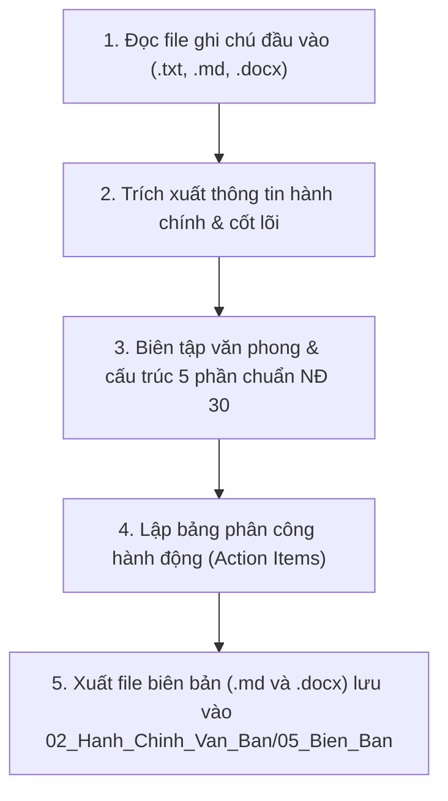

# KỸ NĂNG SOẠN BIÊN BẢN CUỘC HỌP CHUẨN HÀNH CHÍNH (NGHỊ ĐỊNH 30/2020/NĐ-CP)

Kỹ năng này hướng dẫn Agent tự động chuyển đổi file ghi chú thô, bullet points, hoặc bản ghi chép cuộc họp thành **Biên bản cuộc họp chính thức**, tuân thủ nghiêm ngặt quy định về thể thức văn bản hành chính nhà nước của Việt Nam.

---

## 1. TÀI NGUYÊN & CẤU TRÚC KỸ NĂNG

- **Quy chuẩn thể thức pháp lý:** Xem [Quy chuẩn Nghị định 30/2020/NĐ-CP](./references/nghi-dinh-30-2020-nd-cp.md)
- **Bộ khung mẫu văn bản:** Xem [Các mẫu biên bản chuẩn](./references/templates.md)
- **Dữ liệu ví dụ đối chiếu:**
  - File ghi chú đầu vào mẫu: [ghi_chu_mau.md](./examples/ghi_chu_mau.md)
  - File biên bản đầu ra mẫu: [bien_ban_chuan_mau.md](./examples/bien_ban_chuan_mau.md)
- **Script hỗ trợ xuất Word (.docx):** [export_docx.py](./scripts/export_docx.py)

---

## 2. QUY TRÌNH THỰC HIỆN 5 BƯỚC



### BƯỚC 1: TIẾP NHẬN VÀ ĐỌC FILE GHI CHÚ ĐẦU VÀO
1. Xác định đường dẫn file ghi chú cuộc họp do người dùng cung cấp.
2. Dùng công cụ đọc file (`read_file`) để lấy toàn bộ nội dung.
3. Nếu người dùng chỉ cung cấp văn bản trực tiếp trong chat, tiếp nhận trực tiếp nội dung đó.

### BƯỚC 2: TRÍCH XUẤT CÁC THỰC THỂ THÔNG TIN HÀNH CHÍNH
Rà soát và trích lọc các trường thông tin:
- **Tên cơ quan / Đơn vị tổ chức cuộc họp:** (Ví dụ: `BỆNH VIỆN ĐA KHOA TỈNH - KHOA GIẢI PHẪU BỆNH`).
- **Thời gian & Địa điểm:** Giờ, phút, ngày/tháng/năm; phòng họp; trực tiếp hay trực tuyến.
- **Thành phần:**
  - Chủ tọa / Người chủ trì cuộc họp (Họ tên, chức danh).
  - Thư ký ghi chép (Họ tên, chức danh).
  - Thành viên tham dự (Số lượng có mặt, vắng mặt có lý do / không lý do).
- **Trích yếu cuộc họp:** Tên hoặc mục đích cuộc họp (Ví dụ: *Biên bản cuộc họp giao ban chuyên môn định kỳ...*).

### BƯỚC 3: BIÊN TẬP VĂN PHONG VÀ CẤU TRÚC BIÊN BẢN CHUẨN
Chuyển hóa văn phong ghi chép tự do sang văn phong hành chính trang trọng, súc tích, khách quan:
1. **Khối Header:**
   - Cột trái: Tên cơ quan chủ quản, Tên đơn vị, Số ký hiệu văn bản.
   - Cột phải: Quốc hiệu, Tiêu ngữ, Địa danh & ngày tháng năm (*nghiêng*).
2. **Tiêu đề văn bản:**
   - Căn giữa: `BIÊN BẢN` (In hoa, đậm, cỡ 14).
   - Trích yếu nội dung (Đậm, cỡ 13).
3. **Nội dung 5 phần cốt lõi:**
   - **Phần I: Thời gian và địa điểm**
   - **Phần II: Thành phần tham dự**
   - **Phần III: Nội dung và diễn biến cuộc họp** (Phân đoạn theo từng vấn đề thảo luận, tóm tắt rõ phát biểu của các cá nhân/bộ phận).
   - **Phần IV: Kết luận của Chủ tọa / Chủ trì** (Các nội dung thống nhất, chỉ đạo, và bảng phân công hành động).
   - **Phần V: Thời gian bế mạc và thông qua biên bản** (*"Cuộc họp kết thúc vào hồi ... giờ ... cùng ngày. Biên bản đã được đọc lại trước toàn thể cuộc họp và được 100% thành viên nhất trí thông qua."*).
4. **Khối Chữ ký (Footer):**
   - Cột trái: `THƯ KÝ CUỘC HỌP` (Ký, ghi rõ họ tên).
   - Cột phải: `CHỦ TRÌ CUỘC HỌP` / `CHỦ TỌA` (Ký, ghi rõ họ tên).
5. **Nơi nhận (nếu có):** Căn lề trái, phía dưới chữ ký Thư ký.

### BƯỚC 4: TỔNG HỢP BẢNG PHÂN CÔNG HÀNH ĐỘNG (ACTION ITEMS)
Tất cả các chỉ đạo, giao việc phải được tổng hợp thành bảng Markdown rõ ràng:
```markdown
| STT | Nội dung công việc | Người chủ trì | Đơn vị / Người phối hợp | Thời hạn hoàn thành |
| :-: | :--- | :--- | :--- | :-: |
| 1 | [Tên việc] | [Họ tên] | [Họ tên / Bộ phận] | DD/MM/YYYY |
```

### BƯỚC 5: XUẤT BẢN VĂN BẢN VÀ LƯU TRỮ
1. **Lưu file Markdown (.md):**
   - Đặt tên file theo chuẩn: `YYYY-MM-DD_Bien_Ban_[Trich_Yeu_Ngan_Gon].md`.
   - Vị trí lưu mặc định: `02_Hanh_Chinh_Van_Ban/05_Bien_Ban/` (hoặc thư mục người dùng yêu cầu).
2. **Xuất file Word (.docx) chuẩn thể thức:**
   - Sử dụng script Python `scripts/export_docx.py`.
   - Chuẩn bị file JSON tạm chứa cấu trúc dữ liệu hoặc gọi hàm `create_administrative_minutes` trong script.
   - File docx sẽ được định dạng chuẩn lề: Trái 30mm, Trên 20mm, Dưới 20mm, Phải 20mm, font Times New Roman, Quốc hiệu và Chữ ký nằm trong bảng 2 cột không viền.

---

## 3. CHECKLIST KIỂM ĐỊNH CHẤT LƯỢNG BIÊN BẢN

Trước khi bàn giao kết quả cho người dùng, Agent cần kiểm tra:
- [ ] Đã có đầy đủ Quốc hiệu, Tiêu ngữ, Tên đơn vị, Địa danh và ngày tháng năm chưa?
- [ ] Tiêu đề biên bản có ghi rõ trích yếu nội dung cuộc họp chưa?
- [ ] Đã ghi nhận chính xác thời gian bắt đầu, thời gian kết thúc cuộc họp chưa?
- [ ] Đã nêu rõ Chủ trì, Thư ký, số lượng thành viên dự họp và vắng mặt chưa?
- [ ] Phần diễn biến có ghi trung thực các ý kiến phát biểu của từng thành viên không?
- [ ] Kết luận của Chủ trì có rõ ràng và có bảng phân công nhiệm vụ/thời hạn cụ thể không?
- [ ] Có câu xác nhận thông qua biên bản ở cuối cùng chưa?
- [ ] Hai vị trí chữ ký Thư ký và Chủ trì đã bố trí cân đối ở cuối trang chưa?
