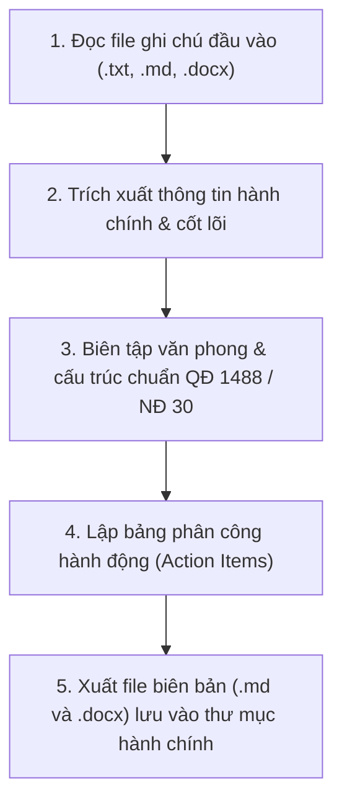

# KỸ NĂNG SOẠN BIÊN BẢN CUỘC HỌP CHUẨN ĐẠI HỌC Y DƯỢC CẦN THƠ
*(Căn cứ QĐ 1488/QĐ-ĐHYDCT, QĐ 1494/QĐ-ĐHYDCT & Nghị định 30/2020/NĐ-CP)*

Kỹ năng này hướng dẫn Agent tự động chuyển đổi thông tin ghi chép thô, bản thảo cuộc họp thành **Biên bản cuộc họp chính thức**, tuân thủ nghiêm ngặt quy định thể thức văn bản quản lý nội bộ của **Trường Đại học Y Dược Cần Thơ** (Mẫu 8 - Biên bản) và quy chuẩn hành chính nhà nước.

---

## 1. TÀI NGUYÊN & CẤU TRÚC KỸ NĂNG

- **Quy chuẩn thể thức ĐHYD Cần Thơ:** Xem [Quy chuẩn QĐ 1488 & QĐ 1494](./references/qd-1488-1494-dhy-duoc-can-tho.md)
- **Quy chuẩn thể thức pháp lý chung:** Xem [Quy chuẩn Nghị định 30/2020/NĐ-CP](./references/nghi-dinh-30-2020-nd-cp.md)
- **Bộ khung mẫu biên bản chuẩn hóa:** Xem [Các mẫu biên bản](./references/templates.md)
  - Mẫu 1: Biên bản họp Bộ môn (Mẫu 8 - QĐ 1488)
  - Mẫu 2: Biên bản sự cố hư hỏng thiết bị (BM04)
  - Mẫu 3: Biên bản giao nhận hóa chất, vật tư (BM06)
- **Dữ liệu ví dụ đối chiếu:**
  - File ghi chú đầu vào mẫu: [ghi_chu_mau.md](./examples/ghi_chu_mau.md)
  - File biên bản đầu ra mẫu: [bien_ban_chuan_mau.md](./examples/bien_ban_chuan_mau.md)
- **Script xuất Word (.docx) chuẩn:** [export_docx.py](./scripts/export_docx.py)

---

## 2. QUY CHUẨN THỂ THỨC ĐẶC THÙ (TRƯỜNG ĐHYD CẦN THƠ)

Khi người dùng không cung cấp đơn vị cụ thể hoặc bối cảnh liên quan đến nhà trường/bộ môn, Agent **MẶC ĐỊNH ÁP DỤNG THÔNG TIN CHUẨN:**

1. **Cơ quan & Đơn vị ban hành:**
   - Cấp Trường: `TRƯỜNG ĐẠI HỌC Y DƯỢC CẦN THƠ`
   - Cấp Khoa: `KHOA Y`
   - Cấp Bộ môn: `BỘ MÔN MÔ PHÔI - GIẢI PHẪU BỆNH - PHÁP Y` (hoặc `BỘ MÔN MÔ PHÔI - GPB - PHÁP Y`)
2. **Số & Ký hiệu biên bản:**
   - Cấp Bộ môn: `Số:    /BB-BMMPGPBPY`
   - Cấp Khoa Y: `Số:    /BB-KY`
   - Cấp Trường: `Số:    /BB-ĐHYDCT`
3. **Địa danh & Ngày tháng:**
   - `Cần Thơ, ngày ... tháng ... năm 20...` (in nghiêng)
4. **Nhân sự phụ trách:**
   - **Chủ trì (Trưởng Bộ môn):** `TS.BS. Nguyễn Hồng Phong`
   - **Thư ký (Kỹ thuật viên):** `KTV. Nguyễn Phúc Duy`
5. **Định dạng trang Word (`export_docx.py`):**
   - Khổ giấy A4, Lề trên 20mm, Lề dưới 20mm, Lề trái 30mm, Lề phải 20mm.
   - Phông chữ: `Times New Roman`.

---

## 3. QUY TRÌNH THỰC HIỆN 5 BƯỚC



### BƯỚC 1: TIẾP NHẬN VÀ ĐỌC FILE GHI CHÚ ĐẦU VÀO
1. Xác định file ghi chú cuộc họp do người dùng cung cấp hoặc văn bản trực tiếp trong chat.
2. Dùng công cụ đọc file (`read_file`) để đọc toàn bộ dữ liệu.

### BƯỚC 2: TRÍCH XUẤT THÔNG TIN HÀNH CHÍNH
Rà soát và trích lọc các trường thông tin:
- **Tên cơ quan / Đơn vị:** (Mặc định: Trường Đại học Y Dược Cần Thơ / Khoa Y / Bộ môn Mô phôi - GPB - Pháp Y).
- **Thời gian & Địa điểm:** Giờ, phút, ngày/tháng/năm; phòng họp (Văn phòng Bộ môn hoặc Phòng họp Khoa).
- **Thành phần:**
  - Chủ trì / Chủ tọa (Họ tên, chức danh: mặc định TS.BS. Nguyễn Hồng Phong nếu là cuộc họp Bộ môn).
  - Thư ký (Họ tên, chức danh: mặc định KTV. Nguyễn Phúc Duy).
  - Thành viên tham dự (Số lượng có mặt, vắng mặt có/không lý do).
- **Trích yếu nội dung:** Mục đích cuộc họp (Giao ban định kỳ, kế hoạch giảng dạy, thẩm định, xử lý sự cố thiết bị...).

### BƯỚC 3: BIÊN TẬP VĂN PHONG HÀNH CHÍNH
- Chuyển ngôn ngữ nói/ghi chép rời rạc thành văn phong hành chính trang trọng, súc tích, mạch lạc.
- Bố cục 5 phần rõ ràng theo Mẫu 8 - QĐ 1488:
  - **I. Thời gian và địa điểm**
  - **II. Thành phần tham dự**
  - **III. Nội dung và diễn biến cuộc họp** (Đánh giá công tác, ý kiến thảo luận, các báo cáo chuyên môn)
  - **IV. Kết luận của Chủ trì** (Đánh giá chung, thống nhất chỉ đạo)
  - **V. Thời gian kết thúc & Lưu hồ sơ** ("Cuộc họp kết thúc vào lúc .... giờ .... cùng ngày...")

### BƯỚC 4: LẬP BẢNG PHÂN CÔNG HÀNH ĐỘNG (ACTION ITEMS)
Tạo bảng Markdown phân công công việc cụ thể tại Phần Kết luận:
```markdown
| STT | Nội dung công việc / Nhiệm vụ | Người thực hiện | Người/Đơn vị phối hợp | Thời hạn hoàn thành |
| :-: | :--- | :--- | :--- | :---: |
| 1 | [Nội dung] | KTV. Nguyễn Phúc Duy | [Bộ phận] | DD/MM/YYYY |
```

### BƯỚC 5: XUẤT FILE BIÊN BẢN (.MD VÀ .DOCX)
1. Tạo file Markdown `.md` hoàn chỉnh theo định dạng mẫu.
2. Tạo file dữ liệu JSON tương ứng và chạy script `export_docx.py` để xuất file Word `.docx` tương ứng.
3. Lưu file vào đúng thư mục hành chính của dự án:
   - File `.md`: `02_Hanh_Chinh_Van_Ban/05_Bien_Ban/BB_YYYYMMDD_[Ten_Cuoc_Hop].md`
   - File `.docx`: `02_Hanh_Chinh_Van_Ban/05_Bien_Ban/BB_YYYYMMDD_[Ten_Cuoc_Hop].docx`
